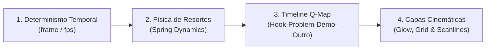

# Code-Driven Video Studio Guide: Programmatic Motion Design
**Ranuk IT Solutions — rk-motion-forge Core Documentation**
*(c) 2026 Ranuk IT Solutions · https://ranuk.dev*

---

## 1. Visión General: El Paradigma de Video Mediante Código

Los métodos tradicionales de video generativo por IA (modelos de difusión como Runway, Luma o Sora) presentan limitaciones críticas para productos de software, fintech y SaaS:
- **Alucinación visual:** Textos borrosos, interfaces deformadas y botones incoherentes.
- **Falta de determinismo:** Imposibilidad de ajustar milisegundos exactos o corregir una coma sin regenerar todo el video desde cero con variaciones no deseadas.
- **Coste y dependencia de API:** Altas tarifas por segundo y tiempos de espera de renderizado en la nube.

Este estudio y motor (`rk-motion-forge`) implementa la metodología de **video generado íntegramente por código**, integrando el conocimiento acumulado de los 8 proyectos y repositorios de referencia más influyentes de la comunidad:

1. **`awesome-opus5-5-videos` (yihui-dev):** Banco maestro de escenas 3D, WebGL, particle fields y motion graphics vectoriales creados con modelos de razonamiento (Claude Opus 5.5 / Gemini / Codex).
2. **`lemo-opuscar` (lemomo-ai):** Colección de 66 estilos visuales cinematográficos generados determinísticamente en código (Canvas, Three.js, SVG, WebGL) con mapeo temporal sincronizado mediante Q-Maps.
3. **`pdoom-video` (mexicat):** Pipeline de sincronización rítmica musical, tipografía cinética estilo karaoke, visuales 3D y renderizado a 4K.
4. **`PDoomVideo` (JohnHeibel):** Narrativa visual reactiva y estéticas procedimentales alternativas.
5. **`mg-styles-15` (Vincentwei1021):** 15 arquetipos de motion graphics de 10-15s (contadores elásticos, escáners láser de código, grids fintech bento, tarjetas deportivas 3D).
6. **`ClaudeAnimationBase` (JohnHeibel):** Dinámica de personajes y cinemática de curvas de rebote (squash & stretch, anticipación y overshoot).
7. **`awesome-claude-5-5-videos` (athemeroy):** Flujos de trabajo de producción, herramientas de renderizado headless y automatización de postproducción.
8. **`opus-video-prompts` (joeseesun):** 54 blueprints y arquitecturas de prompts estructurados para generar animaciones completas en un solo paso.

---

## 2. Los 4 Pilares Técnicos del Video Determinista



### 1. Determinismo Temporal Absoluto
No se utiliza `Math.random()` sin semilla ni estados temporales asíncronos. Cada propiedad (posición, rotación, escala, opacidad, color) es una función pura del número de fotograma actual:
$$\text{Property} = f(\text{frame}, \text{fps})$$
Esto garantiza que el fotograma 240 se vea exactamente igual en cualquier máquina, en cualquier momento y bajo cualquier resolución.

### 2. Física de Resortes (Spring Dynamics)
Para evitar la rigidez robótica de las interpolaciones lineales, se utilizan ecuaciones de amortiguamiento y rigidez (Springs):
```typescript
const springVal = spring({
  frame: frame - offsetFrames,
  fps: 30,
  config: {
    damping: 14,    // Resistencia al movimiento
    mass: 0.65,     // Inercia
    stiffness: 180, // Rapidez de respuesta y rebote
  },
});
```

### 3. Matriz de Tiempos Q-Map (15 Segundos / 450 Frames @ 30fps)
Estructura estándar de alta retención para redes sociales (X, TikTok, Reddit, Product Hunt):
- **Fase 1 (0 – 3.2s / frames 0 – 95): El Hook:** Pregunta disruptiva o contradicción visual. Palabras que saltan en resorte con tipografía cinética.
- **Fase 2 (3.2 – 7.2s / frames 95 – 215): Demostración Heroica:** Interfaz interactiva viva (mockups, escáner láser de código, velas de trading 3D, cartas 3D de clubes).
- **Fase 3 (7.2 – 11.2s / frames 215 – 335): Telemetría y Prueba:** Números masivos que se incrementan elásticamente (KPIs, porcentajes de auditoría, volumen de arbitraje).
- **Fase 4 (11.2 – 15.0s / frames 335 – 450): Clímax y Llamada a la Acción:** Logo con resplandor neón pulsante, badge de repositorio o web, y CTA directo.

---

## 3. Catálogo de Arquetipos y Estilos Visuales

| # | Estilo / Arquetipo | Referencia | Aplicación Ideal | Ejemplo en Ranuk |
|---|--------------------|------------|------------------|------------------|
| **01** | **Sports Broadcast & Kinetic Stadium** | `lemo-opuscar` #12 / `mg-styles` | Juegos deportivos, fan engagement, rankings | `GambetaBroadcastPromo` |
| **02** | **Cyber Laser Inspector & Matrix DOM** | `mg-styles` #08 / `lemo-opuscar` | DevTools, seguridad, auditorías WCAG/ADA | `AdaLaserAuditPromo` |
| **03** | **Fintech Hologram & High-Frequency Quant** | `pdoom-video` / `lemo-opuscar` #24 | Cripto trading, terminales de datos, DeFi | `RanukProfitHoloQuantPromo` |
| **04** | **NextGen Obsidian Glassmorphism** | `rk-motion-forge` canónico | SaaS B2B, extensiones de IA, dashboards | `DataCanvasNextGen` |
| **05** | **Photorealistic Feature Walkthrough** | Screen Studio / Cursor | Product Hunt, demos de CLI, interfaces web | `DataCanvasWalkthrough` |
| **06** | **Indie Showcase (Model 8840FE3E)** | Viral Reddit / Apple Dynamic Island | Utilidades de escritorio, herramientas de productividad | `IndieShowcaseDynamicIsland` |

---

## 4. Nuevos Videos Implementados en el Motor

### 1. Gambeta (`GambetaBroadcastPromo.tsx`)
- **Estilo:** *Sports Broadcast & Kinetic Stadium Match Day*
- **Elementos Clave:**
  - Iluminación cinematográfica de reflectores de estadio en movimiento sobre césped nocturno.
  - Escudos oficiales 3D con perspectiva flotante (AFA, Boca Juniors, River Plate, Talleres de Córdoba).
  - Simulador de toma de decisiones interactivas en el minuto 88' ("Golazo agónico al ángulo").
  - Contadores cinéticos: **7 Países · 16 Categorías · 378 Clubes Reales**.
  - Outro con el escudo y degradado dorado/celeste de Gambeta hacia `gambetafutbol.games`.

### 2. ADA-Audits / AuditBot (`AdaLaserAuditPromo.tsx`)
- **Estilo:** *Cyber Laser DOM Inspector & Compliance Matrix*
- **Elementos Clave:**
  - Consola obsidiana de desarrollo con escáner láser esmeralda en barrido vertical.
  - Detección en vivo de violaciones WCAG (falta de atributos alt, contraste insuficiente, trampas ARIA).
  - Auto-reparación instantánea mediante diff de código git (`-` rojo a `+` esmeralda).
  - Dial elástico circular saltando de **42% (FAIL)** a **99.6% (WCAG 2.1 AAA CERTIFIED)**.
  - Enlace directo a `github.com/RanuK12/AuditBot` y `ranuk.dev/ada`.

### 3. Ranuk Profit (`RanukProfitHoloQuantPromo.tsx`)
- **Estilo:** *Holographic Quant Orderbook & Audio-Reactive Rhythms*
- **Elementos Clave:**
  - Rejilla 3D holográfica con aurora de neón verde y pulsos rítmicos simulando ticks de mercado.
  - Gráfico de velas japonesas 3D con ruptura alcista y línea de trailing stop dinámica.
  - Panel DOM (Depth of Market) con barras de bid/ask actualizándose en microsegundos.
  - Prueba cuantitativa verificada: **78.4% Win Rate · Sharpe 2.84 · Max DD < 1.5%**.
  - Enlace a `ranuk.dev/profit` y `github.com/RanuK12/Ranuk-Profit-Bot`.

---

## 5. Guía de Ejecución y CLI

```bash
# Renderizar Gambeta Broadcast Promo (15s Full HD)
python3 scripts/forge.py --product gambeta-broadcast --no-telegram

# Renderizar ADA Laser Audit Promo (15s Full HD)
python3 scripts/forge.py --product ada-laser-audit --no-telegram

# Renderizar Ranuk Profit Holographic Quant Promo (15s Full HD)
python3 scripts/forge.py --product ranuk-profit-holo --no-telegram

# Listar todas las composiciones y arquetipos
python3 scripts/forge.py --list
```

---

## 6. Automatización de Publicación en Redes (X / Twitter)

Los nuevos videos se encuentran plenamente integrados en el pipeline de rotación automática:
- Script: `scripts/rk-video-promo-x.py`
- Frecuencia: Rotación programada por crons de Ranukita.
- Regla de Publicación: Integración directa con `rk-x-post.py` y `rk_x_guard.py` para asegurar cumplimiento de cuotas de API y espaciado de posts.
